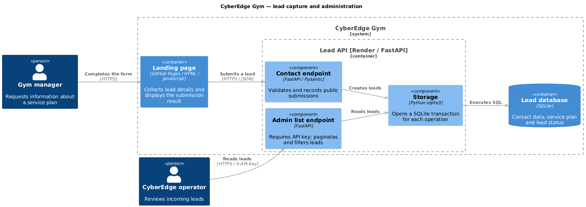

# CyberEdge Gym

Landing page e API de captação de contatos para serviços de infraestrutura edge
para academias. O formulário registra o contato do gestor, a academia, o
WhatsApp e o plano de interesse. Operadores autorizados consultam os leads pela
API.

**Stack:** HTML · JavaScript · Tailwind CSS · Three.js · Tone.js · Python 3.12 ·
FastAPI · Pydantic · SQLite · pytest · Ruff · mypy

## Arquitetura



- `index.html` é publicado diretamente da raiz da branch `main` pelo GitHub
  Pages; não há etapa de build do frontend. `lead-form.js` envia JSON ao backend
  e só confirma o envio após HTTP `201`. Falhas não são salvas no navegador.
- `backend/main.py` valida as solicitações e grava os leads no SQLite. A
  listagem administrativa exige autorização e não permite cache dos dados.
- `backend/config.py` valida as configurações de ambiente. Nenhuma chave
  administrativa é enviada ao frontend.

Fonte: [docs/architecture.puml](docs/architecture.puml). Renderize com Java e
PlantUML 1.2026.2: `java -jar plantuml.jar -failfast2 docs/architecture.puml`.

## Rodar localmente

Pré-requisitos: Python 3.12 com pip e Node.js 24.8+ para lint e testes do
frontend. Docker é opcional para a execução do backend.

```sh
cd backend
python3.12 -m venv .venv
source .venv/bin/activate
python -m pip install -r requirements-dev.txt
cp .env.example .env
uvicorn main:app --env-file .env --reload
```

Em outro terminal, na raiz, execute `python3 -m http.server 5500` e abra
[http://localhost:5500/](http://localhost:5500/). A documentação interativa da
API fica em [http://localhost:8000/docs](http://localhost:8000/docs).

| Variável do backend | Padrão | Função |
|---|---|---|
| `DATABASE_URL` | `cyberedge.db` | Caminho do arquivo SQLite. Caminhos relativos partem do diretório de execução. |
| `ALLOWED_ORIGINS` | GitHub Pages e origens locais de desenvolvimento | Lista de origens CORS explícitas, separadas por vírgula. Para produção, use `https://joaovictoreth1.github.io` (sem o caminho `/Cyberedgegym/`). |
| `LEADS_ADMIN_API_KEY` | vazio | Quando vazio, desabilita apenas a listagem administrativa. Quando definido, deve ter ao menos 32 caracteres ASCII imprimíveis sem espaços. |

Para ativar a listagem, gere uma chave com
`python -c 'import secrets; print(secrets.token_urlsafe(32))'`, guarde-a no
ambiente do backend e configure o cabeçalho `X-API-Key` no cliente administrativo.
Nunca coloque a chave no HTML, no JavaScript ou no Git. A URL pública do backend
está no atributo `data-api-url` do formulário em `index.html`.

Os botões de consulta dos planos preenchem o plano de interesse sem enviar
dados. O formulário mantém os campos em caso de falha e só confirma o envio
quando a API responde com HTTP 201. O site não grava os dados do formulário no
armazenamento do navegador.

| Rota | Comportamento |
|---|---|
| `GET /` | Sondagem pública: `200` se a tabela SQLite estiver acessível; `503` em falha do banco. |
| `POST /api/contato` | Público: `201` após gravar; `422` para dados inválidos. |
| `GET /api/leads` | Privado: `401` se a chave estiver ausente/incorreta; `503` se a listagem estiver desabilitada. Aceita `status`, `tier`, `limit` (1–100) e `offset` (0–1.000.000). |

## Testes, lint e build

Na raiz:

```sh
npm ci
npm run lint
npm test
docker build -t cyberedgegym:local backend
```

No diretório `backend`, com o ambiente Python ativado:

```sh
ruff check .
ruff format --check .
mypy
pytest
```

Os testes usam arquivos SQLite temporários e requisições simuladas, sem tocar
no banco de produção. O CI executa essas verificações em push e pull request.

## Deploy

| Componente | Plataforma | Configuração |
|---|---|---|
| Frontend | [GitHub Pages](https://joaovictoreth1.github.io/Cyberedgegym/) | Branch `main`, raiz `/`; o CI apenas verifica, não publica. |
| Backend | [Render](https://cyberedge-api.onrender.com/) | Root Directory: `backend`; Python 3.12; build: `python -m pip install -r requirements.txt`; start: `uvicorn main:app --host 0.0.0.0 --port $PORT`; health check: `/`. |

O sistema de arquivos padrão do Render é efêmero. Para manter os leads entre
reinícios e novos deployments, faça backup e use um disco persistente com
`DATABASE_URL` apontando para o arquivo no ponto de montagem, por exemplo
`/var/data/cyberedge.db`. Não há migração de schema nesta atualização. O
ambiente antigo `SECRET_KEY` não tinha uso no backend e não é necessário.

Para testar o container localmente com armazenamento persistente:

```sh
docker run --rm --env-file backend/.env -e DATABASE_URL=/data/cyberedge.db \
  --mount source=cyberedge-data,target=/data -p 127.0.0.1:8000:8000 cyberedgegym:local
```

## Planos de serviço

| Tier | Alunos | Preço |
|---|---|---|
| START | Até 500 | R$ 1.000 / trimestre |
| PRO | 501 a 1.000 | R$ 2.000 / trimestre |
| ENTERPRISE | Acima de 1.000 | R$ 3.000 / bimestre |

Contato: [contato@cyberedgegym.com.br](mailto:contato@cyberedgegym.com.br).
Projeto desenvolvido para o **Senac Empreenda 2026**.
